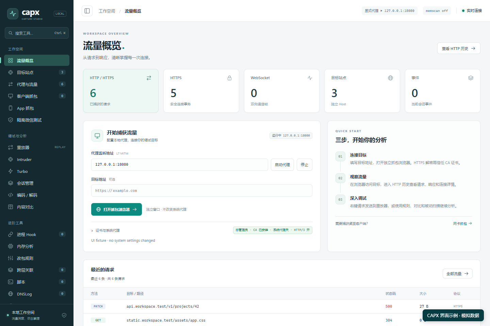
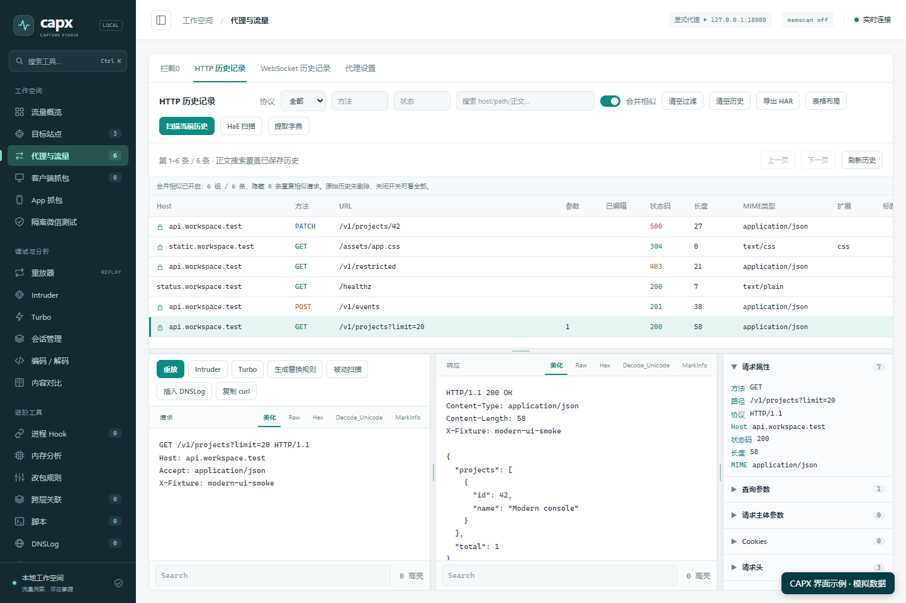
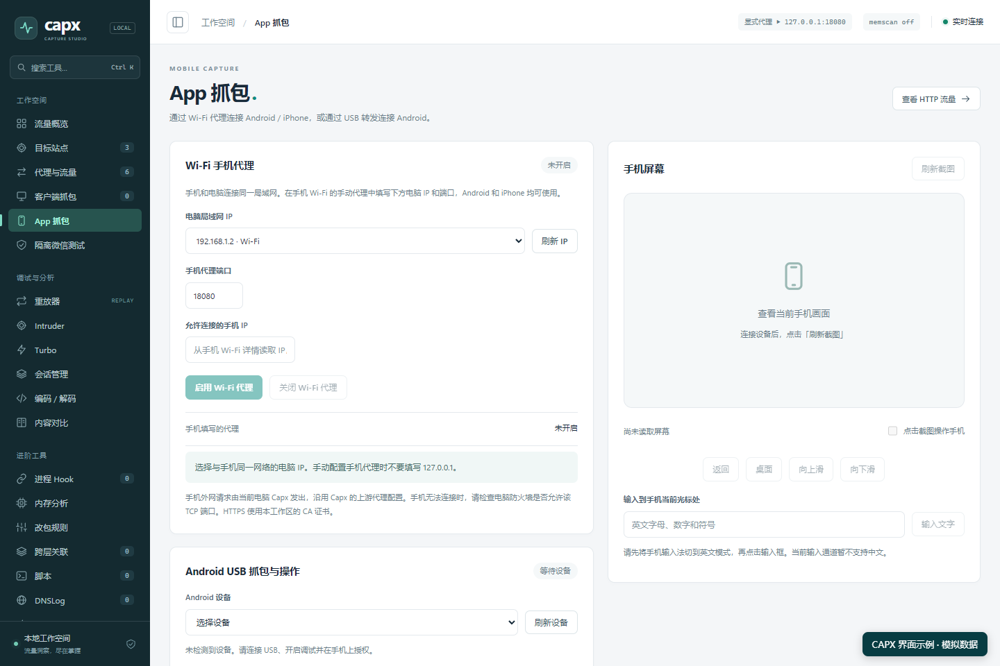

# capx

本地 HTTP/HTTPS 抓包、接口分析与自动化测试工具。提供 Web 控制台、REST API、MCP、Android 操作和 Windows 微信窗口操作。本仓库是经过筛选的公开源码；MIT 许可证适用于此公开仓库的原创代码，第三方代码保留各自许可证，见 [NOTICE](NOTICE.md)。

capx 将流量查看、请求重放、手机测试入口和 AI 工具接入放在同一工作台中，适用于接口调试、流量分析和已授权的自动化测试。

**仓库只提交源码和必要资源，程序由 GitHub Actions 编译。** 上传解压后的源码到仓库根目录，提交后查看 Actions → `build-artifacts`；Windows、Linux、macOS 应用包及原生库从 Artifacts 下载。详细步骤见 [GitHub 编译说明](docs/GITHUB_BUILD.md)。本地编译仅作为可选开发方式。

## 界面示例

以下图片由公开版页面渲染生成，使用模拟请求和设备状态，不包含真实抓包、手机画面或账号资料。

**流量概览**：集中查看 HTTP/HTTPS 请求、目标站点和最近流量。



**接口分析**：查看请求与响应正文、状态码和参数，并进入重放器调试。



**手机 App 抓包**：配置电脑代理地址、允许连接的手机 IP，以及 Android USB 设备。



## 使用示例

- **排查接口500错误**：筛选失败请求，查看参数与响应，发送到重放器验证修改后的请求。
- **测试自己的 Android App**：连接并授权 ADB，选择手机，配置抓包与测试 CA，再结合截图定位界面操作。
- **用 AI 分析流量**：通过 MCP 请求 AI“筛选失败接口，比较请求参数和响应差异，整理排查步骤”。主动执行操作需显式授权。

更多说明见 [项目介绍](docs/INTRODUCTION.md)。iOS 点击/输入尚未统一集成，小程序调试需要外部 CDP；证书固定、业务层加密需要按具体 App 验证。

## 快速开始

需要 Go 1.26.9 或更新版本。默认构建不需要 Python、Rust、微信或抓包驱动。

```powershell
cd capx
go build -mod=readonly -trimpath -o ../bin/captured.exe ./cmd/captured
go build -mod=readonly -trimpath -o ../bin/capx-mcp.exe ./cmd/capx-mcp
../bin/captured.exe -addr 127.0.0.1:19091 -proxy 127.0.0.1:18080 -state-dir ../state
```

Linux/macOS：在 `capx` 目录运行 `bash scripts/build-unix.sh`，然后 `./dist/captured -addr 127.0.0.1:19091 -proxy 127.0.0.1:18080 -state-dir ../state`。

打开 `http://127.0.0.1:19091/`。API 令牌从此实例的 `state/token` 文件读取，启动日志不打印完整令牌。主动操作默认关闭；使用解包、手机 Wi-Fi 监听、注入或自动点击时，在控制台开启主动操作，或启动时显式传入 `-allow-active`。证书安装、系统代理设置由操作者在页面选择。

在 Claude 项目的 `.mcp.json` 中添加下列配置，把路径换成你的绝对路径：

```json
{
  "mcpServers": {
    "capx": {
      "command": "C:/tools/capx/bin/capx-mcp.exe",
      "env": {
        "CAPX_API": "http://127.0.0.1:19091",
        "CAPX_TOKEN_FILE": "C:/tools/capx/state/token",
        "CAPX_MCP_ACTIVE": "0"
      }
    }
  }
}
```

后台需先运行。MCP 主动操作还需显式设置 `CAPX_MCP_ACTIVE=1`；这不替代后台的主动操作开关。请使用令牌文件，避免把真实令牌写进可公开的项目配置。

## 支持范围

| 能力 | 公开版情况 |
| --- | --- |
| HTTP/HTTPS、HTTP/2 代理、历史、重放、WebSocket、MCP | 已集成；默认 Go 测试覆盖本地可控服务 |
| Android USB 抓包、截图、点击、输入、启动 App | 已集成，需要 ADB 授权；应用是否信任 CA 取决于应用配置 |
| iOS Wi-Fi HTTP/HTTPS 抓包 | 已集成电脑端代理；手机需手动配置代理、安装 CA 并完全信任 |
| iOS 点击、输入、WDA 自动化 | 尚未统一接入 `/api/mobile/*`，公开版不包含签名包、配对身份或私有实机脚本 |
| Windows 微信与小程序窗口操作 | 使用自行安装的官方微信，可配合 Windows Sandbox；不内置微信客户端 |
| 已发布小程序 F12、CDP 自动化 | 连接操作者提供的标准 CDP WebSocket；不内置版本 Hook、偏移表或私有调试协议 |
| 所有 App/小程序接口解密 | 无此保证；证书固定、业务层加密、QUIC 等需按应用与环境验证 |
| 原生 pcap / Rust 扫描 / DLL Hook | 可选构建；见 [构建说明](docs/BUILD.md)，不包含预编译驱动或 DLL |

小程序调试：先启动独立安装的调试提供方，取得目标的标准 CDP 地址，设置环境变量再启动 capx：

```powershell
$env:CAPX_CDP_WS = 'ws://127.0.0.1:9222/devtools/page/target-id'
```

在小程序页面启动 CDP 连接。只有目标实际支持相应 CDP 命令时，页面快照、截图和点击才可用；提供方仍负责让微信目标具备调试能力。capx 不会自动安装或分发提供方。

手机 Wi-Fi 模式：选择电脑当前网卡 IPv4，填写手机 Wi-Fi IPv4 白名单；手机代理填电脑 IP 和代理端口。手机与电脑必须互通。Android USB `adb reverse` 把手机端口转发到电脑，因此该模式允许手机使用 `127.0.0.1`。

上游 HTTPS 默认检查证书与域名；私有测试服务或企业 CA 使用 `CAPX_UPSTREAM_CA_FILE` 指向 PEM CA 文件后重启。不要公开 CA 私钥或实例状态。

DNSLog 默认服务地址为 `https://dns.baishax.xyz`，每位使用者需配置自己的 API Key。作者的密钥、用户目录配置和已有 payload 不随源码发布；Windows 持久密钥使用当前用户 DPAPI。

## 测试与贡献

三个模块分别运行 `go test ./...` 和 `go vet ./...`。[GitHub Actions](https://github.com/hquip/capx/actions) 已运行跨平台测试、漏洞检查、原生集成、程序启动与打包验证；以最新工作流结果为准。实机 iOS/WDA 不属于默认测试。

[构建说明](docs/BUILD.md) · [贡献指南](CONTRIBUTING.md) · [安全报告](SECURITY.md) · [变更说明](CHANGELOG.md)
